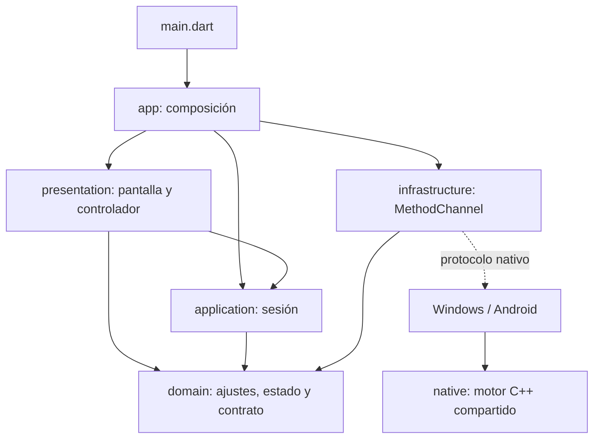

# Arquitectura de Luma

Luma organiza la configuración y el control de sesiones mediante arquitectura
limpia, con dependencias hacia el dominio. La composición conecta los contratos
con sus implementaciones. «Circular» se entiende como capas concéntricas
(onion); las importaciones no forman ciclos.

## Dependencias



Las flechas continuas representan dependencias de código. La aplicación usa
`OverlayGateway`, definido en el dominio; desconoce `MethodChannel`, Windows,
Android y ONNX. El adaptador implementa ese contrato.

## Mapa del repositorio

| Directorio | Responsabilidad |
|---|---|
| `lib/domain/overlay/` | Ajustes inmutables, reglas de activación, estado, errores y puerto `OverlayGateway`. Dart sin Flutter. |
| `lib/application/overlay/` | Activar, consultar, traducir y detener una sesión; evita activaciones duplicadas y resultados tardíos tras el cierre. Dart sin Flutter. |
| `lib/infrastructure/overlay/` | Adaptador del canal nativo; convierte mensajes y excepciones del framework a tipos del dominio. |
| `lib/presentation/overlay/` | Controlador de ajustes, pantalla y componentes de apariencia, proveedor, vista previa y acciones. |
| `lib/presentation/theme/` | Colores y tema de la aplicación. |
| `lib/presentation/widgets/` | Componentes visuales compartidos. |
| `lib/app/` | Construcción e inyección del adaptador, la sesión y el controlador; propiedad y cierre de los recursos. |
| `windows/runner/` | Adaptador Windows: captura, OCR del sistema, ventana flotante, movimiento, canal Flutter y herramientas de evaluación de escritorio. |
| `android/app/src/main/` | Adaptador Android: permisos, MediaProjection, servicio, vistas, ML Kit y puente JNI. |
| `native/` | Motor C++ de OCR/traducción, políticas de recuperación y utilidades nativas. [Guía](../native/README.md). |
| `assets/` | Recursos y modelos que se distribuyen, con licencias y sumas de comprobación. |
| `test/` | Pruebas separadas por dominio, aplicación, infraestructura, presentación y arquitectura. |
| `tools/` | Herramientas de evaluación y experimentos reproducibles. [Índice](../tools/README.md). |
| `benchmarks/` | Protocolos, muestras y decisiones revisadas. [Índice](../benchmarks/README.md). |
| `docs/` | Arquitectura, informes de calidad y decisiones experimentales. [Índice](README.md). |
| `build/` | Compilaciones, entornos locales, pesos experimentales y material de revisión; excluido de Git. No es una carpeta descartable durante estas evaluaciones. |

## Flujo de una sesión

1. La pantalla entrega los cambios al controlador. El controlador mantiene los
   ajustes del formulario y obtiene del dominio si se puede activar la sesión.
2. `OverlaySession.start` vuelve a validar los ajustes antes de invocar el puerto.
   La validación se cumple también con otro cliente que no use esta pantalla.
3. El adaptador convierte los ajustes al protocolo nativo existente
   (`luma/screen_translator`: `start`, `status`, `translate`, `stop`).
4. El estado nativo se recibe por consulta y por eventos. La sesión lo publica y
   la presentación actualiza sus componentes.
5. Una traducción requiere una acción explícita. No se añadieron temporizadores
   de traducción. La captura, el anillo de actividad y la retirada del texto al
   desplazar siguen siendo responsabilidad del adaptador de cada plataforma.

`LumaApp` es dueña del puerto, la sesión y el controlador que construye o recibe
por inyección. Al desmontarse, retira listeners y cierra los canales de estado;
los resultados asíncronos tardíos no actualizan una pantalla destruida. Cerrar
estos objetos Dart no ordena detener una superposición nativa que siga activa.

## Motor nativo y límites de esta reorganización

Windows, Android JNI y las utilidades de línea de comandos enlazan ahora el
mismo target `luma::translation_core`, en lugar de declarar por separado la
compilación del motor. `luma::json` encapsula el include de la dependencia JSON.
Los ejecutables experimentales se declaran aparte y solo se construyen al
habilitar `LUMA_BUILD_TOOLS` (activado por defecto al compilar `native/` solo).

La separación completa de capas está aplicada al control de sesión en Dart.
Los adaptadores nativos conservan sus clases y sus algoritmos de captura, OCR,
disposición y traducción. Esta reorganización no pretende que esas clases
grandes ya se hayan dividido internamente en arquitectura limpia.

Los scripts numerados y fuentes del motor conservan sus rutas: los protocolos
experimentales fijan hashes y algunos scripts importan helpers desde esas
ubicaciones. Se documentan por familia en lugar de moverlos e invalidar la
reproducción de los resultados. Tampoco se modificaron los pesos de producción
ni se promovió el candidato experimental 8034.

## Dónde hacer cambios

- Una regla de idiomas, opacidad o consentimiento: `domain/overlay/overlay_settings.dart`.
- Un flujo de sesión: `application/overlay/overlay_session.dart`.
- Un cambio del protocolo nativo: el adaptador de `infrastructure/overlay/` y los
  correspondientes receptores Windows/Android; cubrir ambos en las pruebas del canal.
- Un ajuste visual: el componente correspondiente de `presentation/overlay/widgets/`.
- Otra implementación del control de captura: implementar `OverlayGateway` e
  inyectarlo desde `LumaApp`, sin importar infraestructura en presentación o aplicación.
- Un nuevo ensayo de modelo: añadir su propio protocolo y herramientas; conservar
  los archivos que identifican los ensayos ya ejecutados.

## Verificación

```powershell
flutter analyze --no-pub
flutter test --no-pub
flutter build windows --release --no-pub
python tools/check_model_assets.py
```

`test/architecture/dependency_rules_test.dart` comprueba la dirección de las
importaciones, la independencia del framework en las capas interiores y la
ausencia de ciclos en `lib/`. Las pruebas del adaptador comprueban los argumentos
del protocolo real; las de interfaz cubren activación manual, consentimiento,
permisos rechazados y tamaños de pantalla. Estas verificaciones no miden la
precisión de traducción: esa evidencia se conserva en los informes de calidad.

### Comprobaciones de esta reorganización — 26 de octubre de 2026

| Comprobación | Resultado |
|---|---|
| `flutter analyze --no-pub` | Sin incidencias. |
| `flutter test --no-pub` | 23 pruebas aprobadas, incluidas las siete pruebas de interfaz migradas. |
| Compilación Windows Release | Correcta. |
| Biblioteca JNI Android ARM64, NDK 28.2 | Compila y enlaza con el motor compartido; no se generó un APK ni se realizó una nueva prueba en dispositivo. |
| Compilación independiente de utilidades nativas | Correcta; se conservan los nombres de los targets. |
| CTest nativo | Dos pruebas aprobadas: cobertura y fondo. |
| Autoprueba Windows | Captura/OCR y «Hello world» → «Hola mundo» sin conexión, con colocación correcta. |
| Prueba de barra Windows | Activación manual, captura detrás de la barra, colocación, arrastre, animación, movimiento, resultados tardíos y cierre aprobados. |
| Manifiesto de modelos | Los 12 archivos mantienen sus sumas de comprobación. |
| Controles de integridad del ensayo 8034 | 18 pruebas aprobadas; esto verifica procedencia y aislamiento, no aprueba su calidad para producción. |

Los informes nativos de esta comprobación están en
`build/architecture/overlay-self-test.json` y
`build/architecture/overlay-toolbar-test.json`. El control de calidad del modelo
sigue siendo independiente de la reorganización del código.
